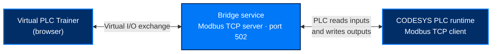

<p align="center">
  
</p>

<h1 align="center">Connect the Universal Virtual PLC Trainer to a PLC</h1>

<p align="center">
  <strong>Bring your own PLC logic into the virtual workstation.</strong><br />
  Connect the trainer to a CODESYS PLC runtime using a Node.js bridge and Modbus TCP.
</p>

<p align="center">
  
  
  
  
</p>

<p align="center">
  <a href="#before-you-start"><strong>Requirements</strong></a> &nbsp;·&nbsp;
  <a href="#start-the-bridge-service">Start the bridge</a> &nbsp;·&nbsp;
  <a href="#configure-the-plc-in-codesys">Configure CODESYS</a> &nbsp;·&nbsp;
  <a href="#verify-the-connection">Verify</a> &nbsp;·&nbsp;
  <a href="#troubleshooting">Troubleshooting</a>
</p>

---

## Overview

**External PLC mode** lets a program running in a PLC read the trainer's virtual field wiring and control its outputs. The trainer still models the bench's electrical connections, but **your PLC program—not the trainer's built-in simulation—determines the output logic**.

| **1. Start the bridge** | **2. Configure the PLC** | **3. Verify the I/O** |
| :--- | :--- | :--- |
| Run the Node.js service and connect the trainer. | Have CODESYS poll the bridge as a Modbus TCP client. | Operate the virtual bench and compare its I/O with the PLC. |

### How the connection works



A browser cannot open the raw TCP socket required for this connection, and the PLC needs to poll a Modbus TCP server. The **bridge** handles that communication: it exposes the trainer's I/O image on **TCP port 502**, serves input values to the PLC, and sends the PLC's coil writes back to the trainer.

> [!IMPORTANT]
> Configure **CODESYS as a Modbus TCP Client**, not a server. Start the bridge **before** attempting to connect the PLC.

## Before you start

| Requirement | Details |
| :--- | :--- |
| **Virtual PLC Trainer** | Open in its normal mode, with at least one exercise completed. |
| **Bridge service** | `universal-plc-trainer-bridge-v1.js` |
| **Node.js** | Version **22 or later**. Verify with `node --version`. |
| **CODESYS** | **V3.5 SP21 Patch 6 or later** and the **CODESYS Control Win V3 x64** runtime. |
| **Device package** | The **Modbus TCP Client** device package must be installed in CODESYS. |
| **Network** | TCP **port 502** must be available on the computer running the bridge. |
| **Optional project** | `{universal-plc-trainer-codesys-v1.project}` — a preconfigured example project that avoids most manual setup. |

> [!NOTE]
> The bridge, Node.js, and CODESYS are only needed for **external PLC mode**. The trainer's internal simulation works without them.

## Start the bridge service

**1. Open a terminal** in the folder containing `universal-plc-trainer-bridge-v1.js`.

**2. Run the bridge:**

```bash
node universal-plc-trainer-bridge-v1.js
```

The bridge prints its register map and starts listening on **port 502**. **Keep the terminal open:** closing it stops the bridge and disconnects the PLC.

**3. Connect the trainer to the bridge.** Open the trainer and select **EXTERNAL PLC**.

The status should now display **BRIDGE ONLY — NO PLC**. This means the trainer has reached the bridge; it is normal before the PLC starts polling.

| Trainer status | Meaning |
| :--- | :--- |
| **Internal mode** | The trainer uses its built-in PLC simulation. |
| **BRIDGE ONLY — NO PLC** | The bridge is connected, but no PLC is polling yet. |
| **PLC POLLING** | A PLC is communicating with the bridge. |

## Configure the PLC in CODESYS

Choose **one** of the two setup paths below. Both end with the PLC polling the bridge.

<details open>
<summary><strong>Option A — Use the provided CODESYS project (recommended)</strong></summary>

The optional example project, `{universal-plc-trainer-codesys-v1.project}`, includes a **Modbus TCP Client**, mapped I/O channels, and a simple test program that drives **DO0 from DI0**.

1. **Open the project in CODESYS.** It was saved in **CODESYS 3.5 SP21 Patch 6 (64-bit)**. If you use a later version, accept its project-update prompt. Earlier versions cannot open it.
2. **Bind the project to your runtime.** Double-click **Device**, select **Scan network**, then select the **CODESYS Control Win V3** instance running on your computer. The example project was originally saved with a different runtime binding.
3. **Check the Ethernet adapter and client address.** Select an Ethernet interface on your computer. Set the Modbus TCP Client's IP address to the **computer running the bridge**. When both run on the same computer, use `127.0.0.1`.
4. **Download and start the PLC program.** The trainer status should change from **BRIDGE ONLY — NO PLC** to **PLC POLLING**.

**Next:** Skip the manual setup and go to [Verify the connection](#verify-the-connection).

</details>

<details>
<summary><strong>Option B — Configure your own CODESYS project</strong></summary>

1. **Add a Modbus TCP Client** under the Ethernet adapter in the CODESYS device tree. Use **Modbus TCP Client**, *not* the legacy **Modbus TCP Master**; the legacy device has a different configuration dialog and does not work with this bridge.
2. **Enter the bridge address.** Set the client's IP address to the computer running the bridge and the TCP port to **502**. If the bridge is on the same computer as the CODESYS runtime, use `127.0.0.1`.
3. **Configure Modbus channels** for the signals your application needs. Use the [register map](#modbus-register-map) below, the map printed at bridge startup, or the map in the trainer's **PLC & I/O** tab.
4. **Create a simple test program.** Read **DI0** and use its state to control **DO0**. This is enough to test the connection before adding more logic.
5. **Download and start the PLC program.** The trainer status should change from **BRIDGE ONLY — NO PLC** to **PLC POLLING**.

</details>

### Modbus register map

| Modbus address | Type | Signal | Data flow |
| :--- | :--- | :--- | :--- |
| `10001–10004` | Discrete input | **DI0–DI3** | PLC reads |
| `30001–30002` | Input register | **AI0–AI1** (raw counts) | PLC reads |
| `00001–00002` | Coil | **DO0–DO1** | PLC writes |
| `40001` | Holding register | **AO0** (reserved) | Not used in this version |

**Analog inputs:** AI0 and AI1 are provided as **raw counts**, not engineering units. Scale them in the PLC program using the trainer's documented scale, just as you would with a physical analog module.

> [!WARNING]
> **Check your register offsets.** The table uses conventional **1-based Modbus addresses**. CODESYS channel configuration may instead expect **0-based offsets**: for example, DI0 is **offset 0**, not `10001`. All-zero values or signals shifted by one address often indicate this mismatch.

<!-- OPTIONAL SCREENSHOT:
Add a screenshot of the trainer's PLC & I/O tab showing the live register values:

<p align="center">
  
</p>

Confirm the file location and commit the image before enabling it.
-->

## Verify the connection

Once the trainer says **PLC POLLING**, confirm that both sides see the same values.

1. **Operate the bench.** Switch the trainer to **Operate** mode and press its push button. If your test program copies **DI0 to DO0**, the pilot light should turn on while the button is held.
2. **Compare the I/O.** Open the trainer's **PLC & I/O** tab and watch the signal values change. Compare them with the corresponding values in CODESYS. Any disagreement may indicate an addressing or mapping problem.
3. **Return to internal mode when finished.** Press **EXTERNAL PLC** again. The trainer resumes its built-in simulation; you may leave the bridge running or stop it.

> [!TIP]
> If a coil changes in CODESYS but the pilot light does not respond, verify that the trainer is in **Operate** mode and that the output module and lamp are powered and wired correctly.

## Troubleshooting

If the setup does not behave as expected, expand the relevant section.

<details>
<summary><strong>Bridge and connection problems</strong></summary>

| Symptom | Likely cause and fix |
| :--- | :--- |
| **The bridge exits with a version or syntax error.** | Node.js may be older than **22**. Check `node --version` and update if needed. |
| **The address or port is already in use.** | Another process, such as a Modbus tool or a previous bridge instance, is holding **TCP port 502**. Close that process and restart the bridge. |
| **The bridge reports a permission error on startup.** | Port **502** is privileged on macOS and Linux. Use an appropriately authorized environment or remap the port if the build supports it. |
| **The trainer stays in internal mode after selecting EXTERNAL PLC.** | It cannot reach the bridge. Confirm the bridge is running and check local firewall or browser restrictions. |
| **The trainer stays on BRIDGE ONLY — NO PLC.** | The PLC is not polling. Verify that the program is running, IP/port settings are correct, and the device is **Modbus TCP Client**, not the legacy Master. |
| **The connection drops during use.** | The bridge terminal may have closed, the computer may have slept, or the network path may have changed. Restart the bridge and select **EXTERNAL PLC** again. |

</details>

<details>
<summary><strong>CODESYS and runtime problems</strong></summary>

| Symptom | Likely cause and fix |
| :--- | :--- |
| **CODESYS cannot open the provided project.** | The installed CODESYS version is older than the project's version. Use **3.5 SP21 Patch 6** or later. |
| **A device in the tree is unresolved or missing.** | Install the **Modbus TCP Client** device package, then reopen the project. |
| **CODESYS reports no gateway or cannot find the device.** | The project may still reference the original runtime. Open **Device → Scan network** and choose your local **Control Win V3** instance. |
| **The Modbus client is offline or times out.** | Check the client's IP address, firewall access to **port 502**, and whether the bridge is running. |
| **The runtime stops after a period of operation.** | An unlicensed **CODESYS Control Win V3** runtime stops when its demo period expires. Restart the runtime. |

</details>

<details>
<summary><strong>Register mapping and bench behavior</strong></summary>

| Symptom | Likely cause and fix |
| :--- | :--- |
| **Values stay at zero or appear shifted by one address.** | Check for **0-based versus 1-based addressing**. See the warning under the register map. |
| **Coils are written but the bench does not respond.** | Switch the trainer to **Operate** mode. Confirm the output module's supply wiring and the device's return path; a coil write cannot energize an unpowered output. |

</details>

For any other issue, contact the support representative listed in the main `README.md`. Include **what you did, what you expected, and what happened**. If possible, attach the **bridge's startup output** and a screenshot of the trainer's **PLC & I/O** tab.

## See also

| Resource | Purpose |
| :--- | :--- |
| [Getting-started guide](how-to_get-started.md) | Open the trainer and complete your first exercise. |
| [Application README](README.md) | Product overview, support contact, and general requirements. |
| [Browser Compatibility](README.md#browser-compatibility) | Supported browsers and minimum versions. |
| **Known simplifications and scope** *(link to be added)* | What the trainer models and what it intentionally simplifies. |
| **System tab (inside the trainer)** | Glossary, I/O address map, and simulation behavior. |

---

<p align="center"><sub>Universal Virtual PLC Trainer · Published by <strong>Weintek USA</strong></sub></p>

